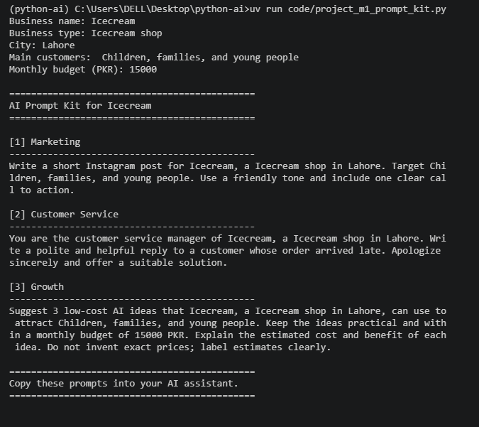
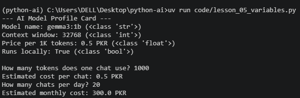
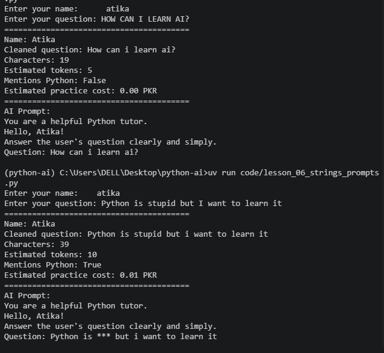
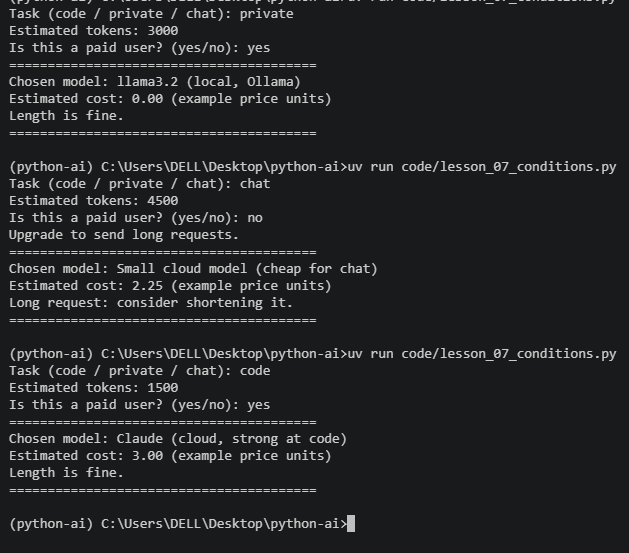
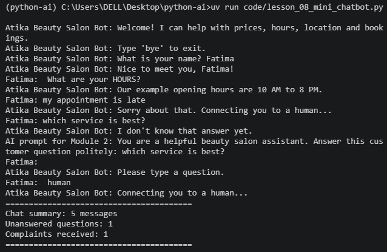

# Python for AI

**Student:** Atika Shafiq

**Course:** Python for AI

## My AI Goal

My goal is to become an AI/ML Engineer and build practical AI solutions for real-world business problems.

## How to Run

Run the main program:

```bash
uv run main.py
```

Run the introduction task:

```bash
uv run code/lesson_01_intro.py
```

## Lessons Completed

- Lesson 1.1: Your AI Career Intro
- Lesson 1.2: Toolkit Proof
- Lesson 1.3: Client-Ready Repo
- Lesson 1.4: Business Prompt Builder
- Lesson 1.5: Variables and Data Types
- Lesson 1.6: Working with Text (Strings)
- Lesson 1.7: Operators and Making Decisions
- Lesson 1.8: Mini Project — Rule-Based Chatbot


## Module 1 Project: AI Prompt Kit

A Python tool that turns a local business's details into
3 ready-to-use AI prompts for marketing, customer service,
and business growth.

**Run:**

```bash
uv run code/project_m1_prompt_kit.py
```



**Who would pay for this:** Local small business owners who
want to use AI for their daily business tasks but do not
know how to write effective prompts.


### Lesson 1.5: Variables and Data Types



### Lesson 1.6: Working with Text (Strings)



### Lesson 1.7: Operators and Making Decisions




## Lesson 1.8: Business Helper Bot

**Business:** Atika Beauty Salon

| Intent | Keywords | Reply |
|---|---|---|
| Complaint | complaint, refund, late | Connect to a human |
| Opening hours | hours, open, time | Open 10 AM to 8 PM |
| Prices | price, cost, charges | Ask about a service |
| Location | location, address, where | Main Boulevard, Lahore |
| Booking | booking, appointment | Contact us to book |
| Greeting | hi, hello, salam | Friendly greeting |
| Exit | bye, exit | Goodbye and summary |
| Other | No matching keyword | Show an AI prompt |

### Lesson 1.8: Chatbot Output


